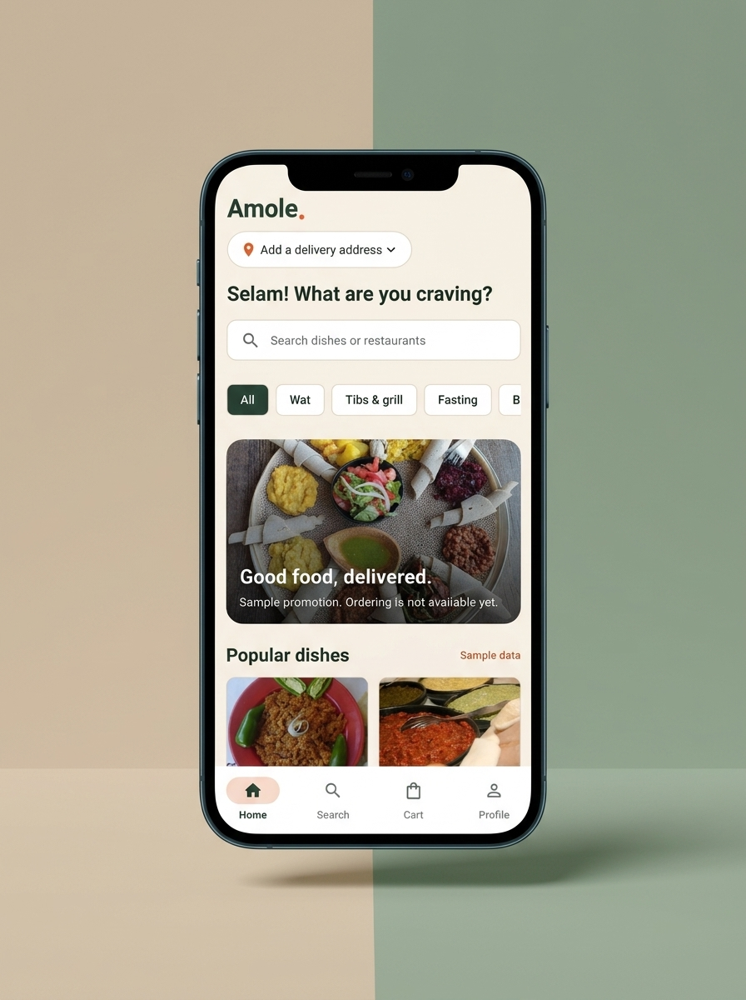
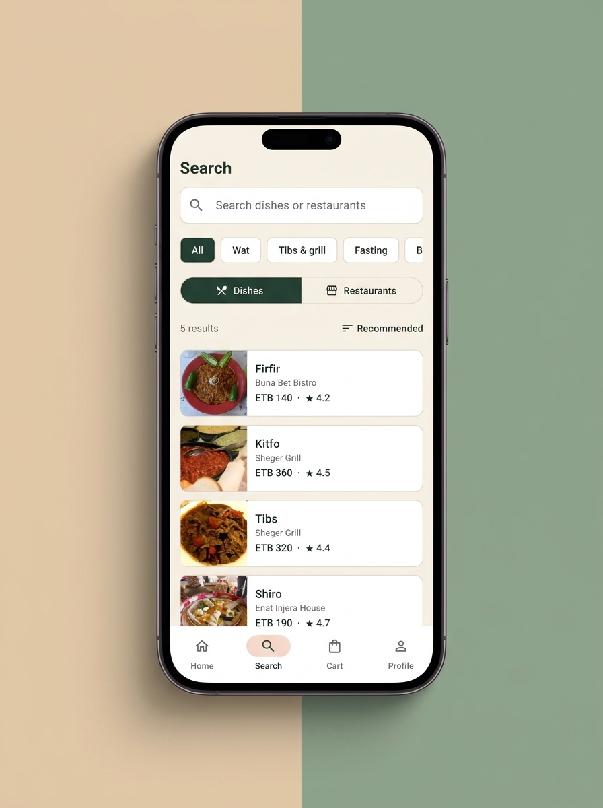
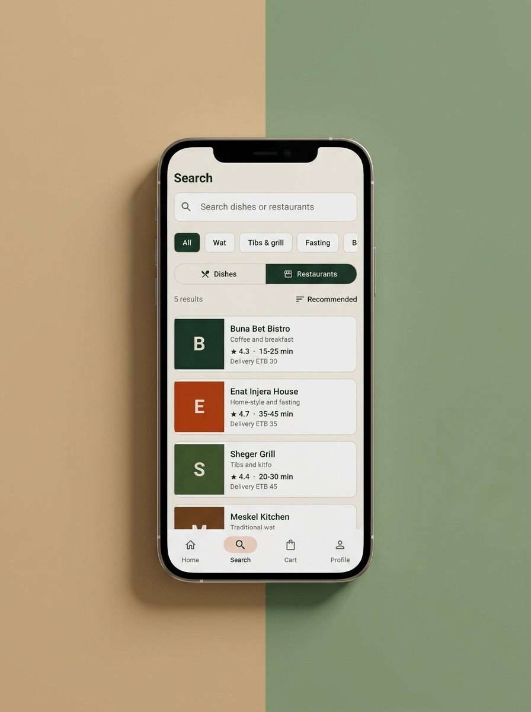
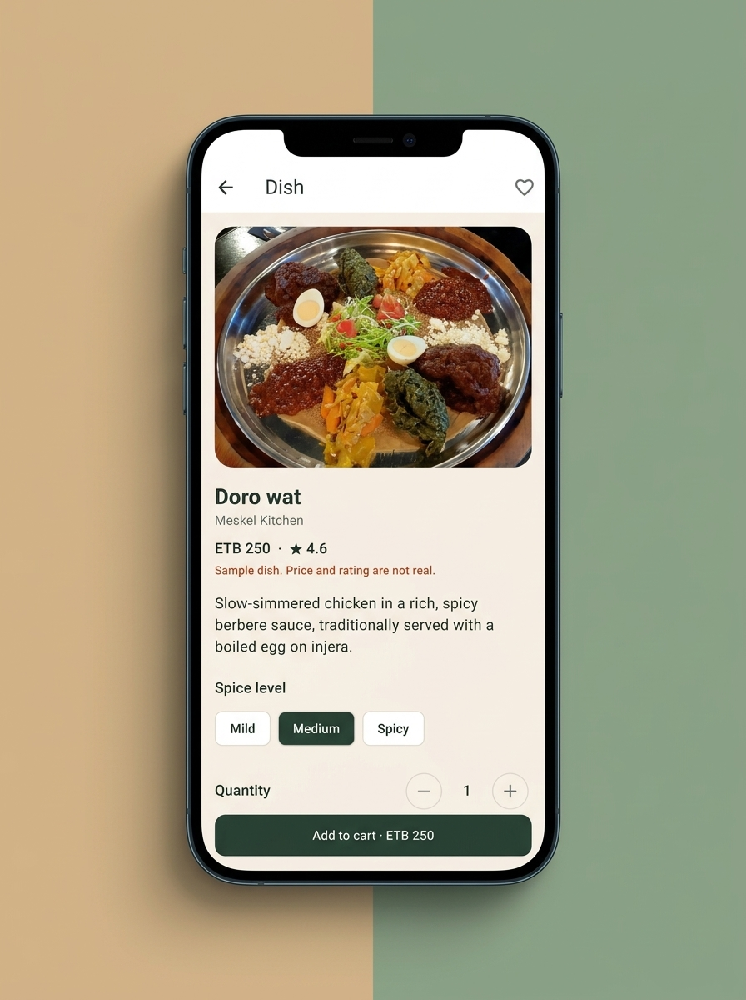
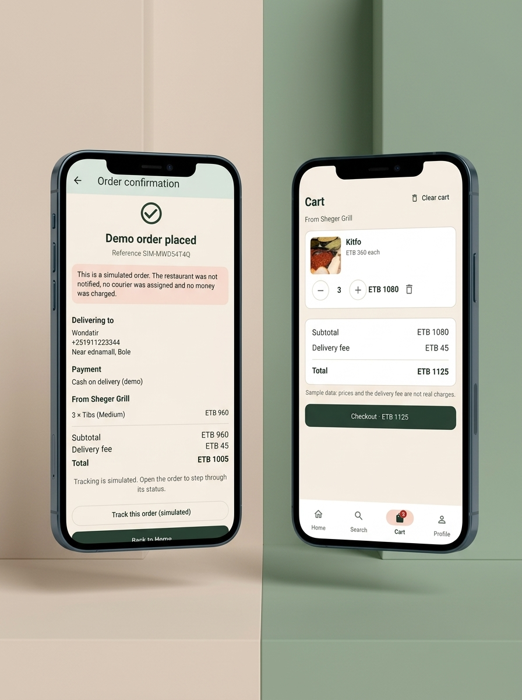
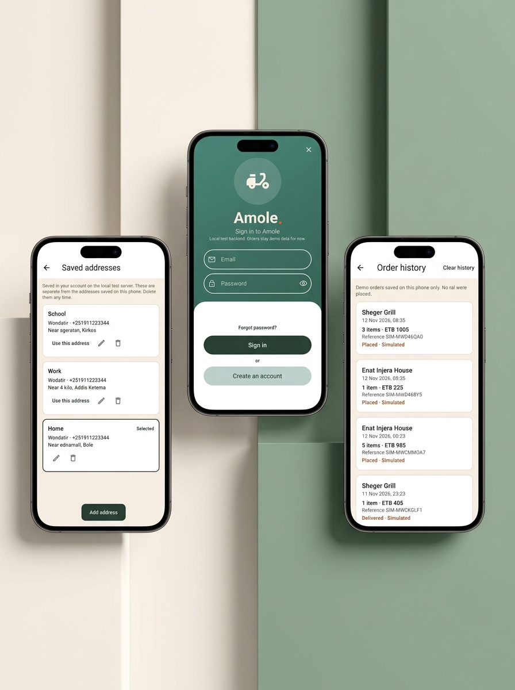

# Amole

**Good food, delivered.**

Amole is an Ethiopian food-delivery mobile app prototype built with Flutter and Supabase. It explores how customers could discover restaurants, browse Ethiopian dishes, manage favorites, and prepare food orders through a modern mobile experience.

> **Project status: Working prototype.** The application has a hosted backend and has been tested on a physical Android device. It is not a live food-delivery service. There are no operational restaurant partners, real order fulfillment, or payment processing.

## Features

### Mobile application

- Restaurant discovery and browsing.
- Food search with filtering and sorting.
- Restaurant pages and dish details.
- Favorites and shopping cart.
- Checkout interface, demo order history, and cancellation interface.
- Customer profiles and saved delivery addresses.
- Offline fallback using sample menu data.

### Authentication and backend

- Supabase email and password authentication.
- Email verification.
- Hosted PostgreSQL database.
- Restaurant and dish catalog loaded from Supabase.
- Customer address storage.
- Row Level Security (RLS) policies and database functions.
- Database migrations, seed data, and SQL tests.

## Screenshots

|               Home               |            Restaurant Discovery            |
| :------------------------------: | :----------------------------------------: |
|  |  |

|                    Restaurant Menu                     |                   Dish Details                   |
| :----------------------------------------------------: | :----------------------------------------------: |
|  |  |

|                    Cart & Checkout                     |                     Profile & Orders                     |
| :----------------------------------------------------: | :------------------------------------------------------: |
|  |  |

### Technologies

- **Flutter & Dart** — mobile application
- **Supabase** — authentication and backend
- **PostgreSQL** — relational database
- **Riverpod** — state management
- **GoRouter** — navigation
- **SharedPreferences** — local preferences

## Prototype limitations

Some interfaces and backend capabilities are not yet connected into a complete operational service.

- Checkout and order tracking use demo orders stored on the device. The app does not yet use the server-side ordering workflow.
- Order status changes are simulated.
- Cash on delivery is presented as a demo option. Telebirr and CBE Birr are not integrated.
- Restaurant names, menus, prices, ratings, delivery fees, and delivery times are sample data.
- There are no restaurant staff applications, courier operations, or real deliveries.
- No live GPS tracking or push notifications.
- Password reset completion through deep links is not implemented.

## Tested functionality

The hosted prototype has been tested on a Samsung Galaxy M15:

1. Account registration and profile access.
2. Email verification.
3. Sign-in and menu loading from the hosted backend.
4. Saving a customer delivery address.
5. Sign-out, subsequent sign-in, and offline menu fallback.

## Getting started

### Prerequisites

- Flutter SDK
- Dart SDK
- Android Studio or an Android device
- A Supabase project

### 1. Clone the repository

```bash
git clone https://github.com/wondie3/Amole.git
cd Amole
```

### 2. Install dependencies

```bash
flutter pub get
```

### 3. Configure Supabase

Create an `env` directory if it does not already exist.

Create `env/hosted.json` with your own Supabase project URL and publishable key:

```json
{
  "SUPABASE_URL": "YOUR_SUPABASE_PROJECT_URL",
  "SUPABASE_ANON_KEY": "YOUR_SUPABASE_PUBLISHABLE_KEY"
}
```

Use the exact environment variable names expected by the application. Check the Supabase initialization code if they differ.

Get the URL and publishable key from your Supabase project settings.

**Security:** Never commit `env/hosted.json`, a service-role key, database password, or signing credentials. The hosted configuration file is excluded by `.gitignore`.

### 4. Run the application

```bash
flutter run --dart-define-from-file=env/hosted.json
```

The application also supports an offline sample-data fallback.

## Database

The `supabase/` directory contains:

- `migrations/` — database schema and incremental changes.
- `seed.sql` — sample restaurant and dish data.
- `schema.sql` — schema reference.
- `policies.sql` — Row Level Security policies.
- `functions.sql` — database functions.
- `tests/database/` — SQL database tests.

The hosted project has been initialized with sample catalog data. For a fresh Supabase project, review the migrations and database configuration before applying them.

## Tests and code quality

Run Flutter tests:

```bash
flutter test
```

Run static analysis:

```bash
flutter analyze
```

Run Supabase database tests against a local development instance:

```bash
npx supabase test db
```

Do not run experimental database changes against a production project without reviewing them first.

## Repository structure

```text
amole/
├── android/
├── assets/
├── docs/
├── env/
├── lib/
├── supabase/
│   ├── migrations/
│   ├── tests/
│   ├── schema.sql
│   ├── policies.sql
│   ├── functions.sql
│   └── seed.sql
├── test/
├── pubspec.yaml
└── README.md
```

## Future improvements

- Integrate the mobile checkout with the server-side ordering workflow.
- Implement real payment-provider integrations.
- Build restaurant and courier interfaces.
- Add live order tracking and notifications.
- Improve secure local session and data storage.
- Complete password reset and deep-link support.
- Conduct a full security review before real-world deployment.

## Photo credits

Food image credits and license information are maintained in `assets/images/ATTRIBUTIONS.md`.

---

**Built as a Computer Science project exploring mobile application development, backend integration, and digital food-delivery experiences in Ethiopia.**
